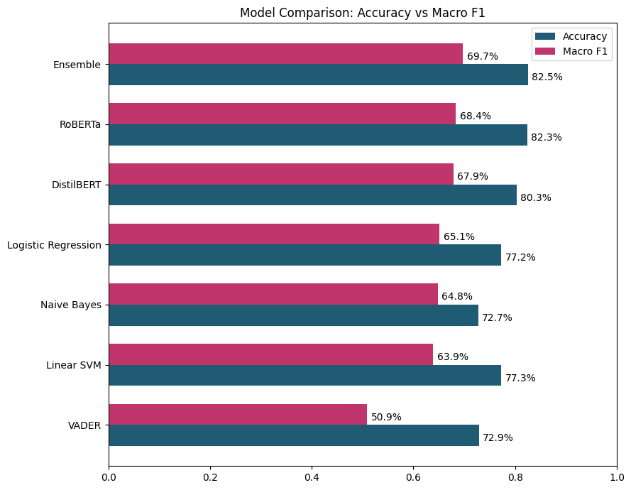
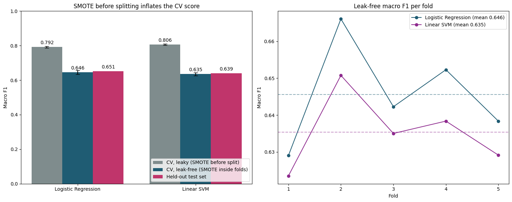
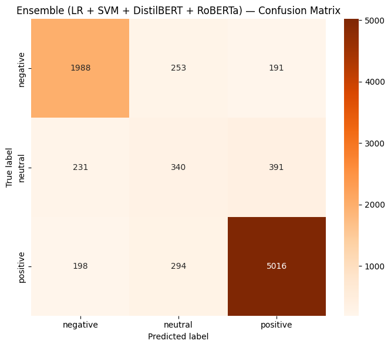

# Student Feedback Sentiment Analysis

**MSc Computer Science dissertation, Anglia Ruskin University (2026)**

UK universities collect far more free-text student feedback than staff can read in time to act on it. This project builds and evaluates an NLP pipeline that labels student comments as **positive, negative or neutral**. It compares seven models, from a rule-based lexicon to fine-tuned transformers, on one shared test set, and presents the results to academic staff through a lightweight Streamlit dashboard.



## Highlights

- **44,516 comments** merged from three public education-feedback datasets
- **7 models compared on the same 8,902-comment test set:** VADER, Naive Bayes, Logistic Regression, Linear SVM, DistilBERT, RoBERTa and a soft-voting ensemble
- **Best result:** the ensemble, with **82.5% accuracy and 0.697 macro F1**
- **Data-leakage finding:** applying SMOTE *before* cross-validation inflated macro F1 by **14–17 points**. A leak-free pipeline, which applies SMOTE inside each training fold, matched test scores to within one point.
- **Practical deployment:** the dashboard serves a 0.3 MB Logistic Regression model that classifies a comment in under 1 ms on free CPU hosting

## Results (held-out test set)

| Model | Accuracy | Macro F1 |
|---|---|---|
| VADER (lexicon baseline) | 72.9% | 0.509 |
| Naive Bayes (TF-IDF + SMOTE) | 72.7% | 0.648 |
| Linear SVM (TF-IDF + SMOTE) | 77.3% | 0.639 |
| Logistic Regression (TF-IDF + SMOTE) | 77.2% | 0.651 |
| DistilBERT (fine-tuned) | 80.3% | 0.679 |
| RoBERTa (fine-tuned) | 82.3% | 0.684 |
| **Soft-voting ensemble** (LR + SVM + DistilBERT + RoBERTa) | **82.5%** | **0.697** |

A bootstrap test gives a 95% confidence interval of +0.005 to +0.022 for the ensemble's macro-F1 gain over RoBERTa, so that gain is unlikely to be chance.

### Leaky vs leak-free cross-validation



When SMOTE is applied before splitting, synthetic samples built from validation-fold neighbours leak into training. Cross-validation then reports about 0.80 macro F1, while the true test score is about 0.65. Putting TF-IDF, SMOTE and the classifier in one `imblearn` pipeline fixes this.

## Pipeline

1. **Data:** three public corpora merged, with each row recording its source and how its label was obtained (star-rating-derived or human-given)
2. **Cleaning:** lowercasing, URL/HTML removal, repeated-letter normalisation, NLTK tokenisation and lemmatisation
3. **Negation tagging:** the five tokens after a negation word are tagged `_NEG`, so "not helpful" becomes `not helpful_NEG` and is not read as praise. This runs *before* stop-word removal, because "not" is itself a stop word.
4. **Split:** a stratified 70 / 10 / 20 split into train, validation and test
5. **Class imbalance:** SMOTE on TF-IDF vectors for the classical models; WordNet synonym augmentation plus a class-weighted loss for the transformers
6. **Models:** 5,000 TF-IDF unigram/bigram features for the classical models. `distilbert-base-uncased` and `cardiffnlp/twitter-roberta-base-sentiment-latest` were fine-tuned with Hugging Face Transformers for up to 6 epochs.
7. **Evaluation:** per-class precision, recall and F1, confusion matrices, a label-noise audit, and McNemar and bootstrap significance tests



## Key insight: the neutral class

No model reached the 0.80 macro-F1 target, and almost all of the shortfall is in the **neutral** class (best F1 0.364). An audit of the test set found many neutral labels that contradict the text. For example, "Her power point lecture sucks!" is labelled neutral. This happens because 84% of labels were derived from star ratings rather than from reading the comment. Some of the remaining error is therefore a labelling ceiling rather than a model failure.

## Tech stack

Python · pandas · NumPy · NLTK · scikit-learn · imbalanced-learn · VADER · PyTorch · Hugging Face Transformers & Datasets · matplotlib · seaborn · Streamlit · Google Colab (GPU)

## Repository structure

```
├── notebooks/
│   └── student_feedback_sentiment_analysis.ipynb   # full pipeline, experiments and results
├── images/                                         # charts used in this README
├── data/
│   └── README.md                                   # where to download the datasets
├── requirements.txt
└── README.md
```

## Running the notebook

The notebook was written for **Google Colab** with a GPU runtime, which the transformer cells need.

1. Download the datasets listed in [`data/README.md`](data/README.md) and merge them into `Dataset.csv`
2. Upload `Dataset.csv` to `MyDrive/Project/` in Google Drive
3. Open the notebook in Colab, set **Runtime → Change runtime type → GPU**, and run all cells

To run it locally instead: `pip install -r requirements.txt`, remove the `google.colab` drive-mount cell, and change the file paths.

## Limitations and future work

- Most labels are derived from star ratings, which limits how far the measured accuracy can be trusted
- Usability testing of the dashboard with academic staff is still outstanding
- Next steps: aspect-based sentiment (what a comment is about, not just its tone), batch upload with trend views, and re-labelling a human-annotated neutral subset

## Author

**Nauman Patel**, MSc Computer Science, Anglia Ruskin University
[LinkedIn](https://www.linkedin.com/in/nauman-patel/) · [GitHub](https://github.com/Nauman7861)

Supervisor: Dr Arooj Fatima
